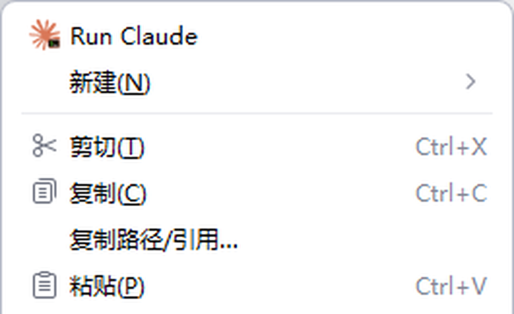
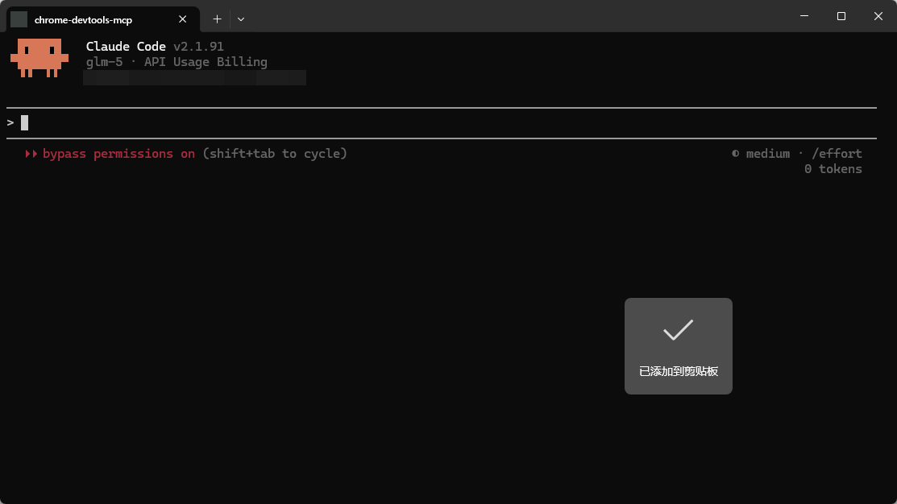
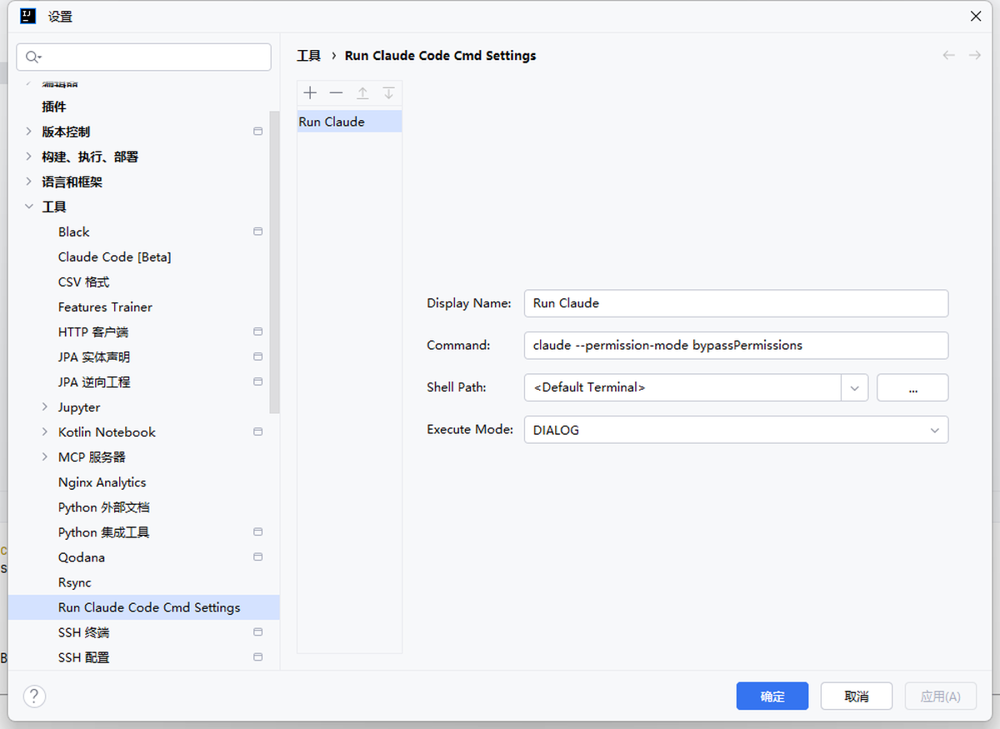
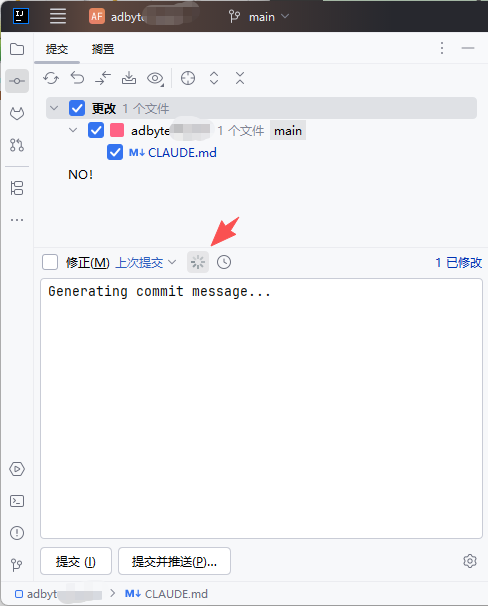

# Run Claude Code Cmd Any Where

An IntelliJ IDEA plugin for running **any CLI command** in the selected directory from the right-click menu, plus writing Git commit messages with AI and customizable prompts.

> 不仅限于 Claude Code：可以把 Claude Code、Codex、Gemini CLI、构建/测试命令或自定义脚本配置成右键快捷命令；同时支持根据代码变更和自定义提示词生成 Git 提交信息。

## Screenshots

| Right-click Menu | Settings | Execution |
|:---:|:---:|:---:|
|  |  |  |

## Features

### Run Any CLI Command

- **Not limited to Claude Code** - Run any executable, CLI tool, build command, or shell script
- **Run in the selected directory** - Right-click a project, directory, or file in Project View
- **Multiple command presets** - Give each command a display name and expose it as a shortcut menu item
- **Customizable command presets** - Configure commands in Settings → Other Settings → Run Claude Code Cmd
- **Multiple execution modes** - IDE Terminal or External Terminal window
- **Shell path selection** - Auto-detect system shells (CMD, PowerShell, Git Bash, WSL, etc.)

Example presets:

| Display Name | Command | Use Case |
|---|---|---|
| Claude Code | `claude --permission-mode bypassPermissions` | Start Claude Code in the selected directory |
| Codex | `codex` | Start Codex CLI |
| Run Tests | `./gradlew test` | Run a project task without opening a terminal manually |
| Custom Script | `./scripts/check.sh` | Run a repository-specific workflow |

### AI Git Commit

Generate Git commit messages with AI based on your code changes. Open the Commit dialog (`Ctrl+K`) and click **Generate AI Commit Message**; the result is filled into the commit message editor.

- Analyze the selected/staged changes and generate a concise commit message
- Choose the output language and LLM provider
- Create and reuse custom prompt templates in the settings page
- Add `commit-prompt.txt` to the project root for repository-specific writing rules
- Configure file exclusion rules to keep generated files and unrelated changes out of the AI input



> 在提交面板（Commit 对话框）上点击 **Generate AI Commit Message**，即可用 AI 根据本次代码变更生成提交信息，并自动填入 commit message 编辑框。
>
> On the commit panel, click **Generate AI Commit Message** to generate a commit message with AI based on your staged changes; the message is filled into the commit message editor automatically.

Supported LLM providers:

- DeepSeek
- Gemini
- SiliconFlow (Model Hub)
- Ollama
- OpenAI API
- Cloudflare Workers AI
- 阿里云百炼 (Model Hub)
- 火山引擎 (VolcEngine)
- OpenRouter
- Kimi (Moonshot AI)
- OpenAI Compatible LLMs

Default provider is 阿里云百炼 with model `qwen3-coder-flash`. Prompt behavior can be customized globally in the settings page or per project with `commit-prompt.txt` in the project root.

> The AI Git Commit feature is derived from [HMYDK/AIGitCommit](https://github.com/HMYDK/AIGitCommit)
> under AGPL-3.0. See [NOTICE.md](NOTICE.md) and [LICENSE-AGPL-3.0](LICENSE-AGPL-3.0).

## Installation

1. Download from JetBrains Plugin Repository: https://plugins.jetbrains.com/plugin/31067-run-claude-code-cmd-any-where
2. Or manually install: `build/distributions/run-claude-code-cmd-anywhere-*.zip`

## Configuration

Go to **Settings → Other Settings → Run Claude Code Cmd**. It contains two tabs:

- **AI Commit** - LLM provider, model, API key, language, custom prompts, file exclusion rules, proxy
- **Commands** - Right-click command presets

### Commands tab

- **Display Name**: Menu item name
- **Command**: Any CLI command to execute, including arguments, shell commands, or scripts
- **Shell Path**: Select from detected shells or enter custom path
- **Execute Mode**:
  - `TERMINAL` - Run in IDE built-in terminal
  - `DIALOG` - Run in external terminal window

## Usage

### Run a CLI command

1. Right-click on any directory/file in Project View
2. Select one of the configured command presets
3. The command runs with the selected directory as its working directory

### Write a commit message with AI

1. Open the IDE Commit dialog (`Ctrl+K` / `Cmd+K`)
2. Select the changes to include
3. Click **Generate AI Commit Message**
4. Review and edit the generated text before committing

Custom prompt templates can be managed under **AI Commit** settings. For project-specific instructions, create `commit-prompt.txt` in the repository root and include the required `{diff}` placeholder; `{language}` is optional for project prompts.

## Build

```bash
./gradlew buildPlugin
```

Plugin package: `build/distributions/run-claude-code-cmd-anywhere-*.zip`

## Publish

First time: Manual upload to https://plugins.jetbrains.com/author/me

Subsequent updates — set the plugin token as an environment variable (recommended, one-time):

```bash
# PowerShell (user-level, persists across sessions; reopen terminal to take effect)
[Environment]::SetEnvironmentVariable('JETBRAINS_PLUGIN_TOKEN','YOUR_TOKEN','User')
# or bash
export JETBRAINS_PLUGIN_TOKEN=YOUR_TOKEN
```

Then publish:

```bash
./gradlew publishPlugin
```

> Never commit the real token or place it directly in a command line. GitHub Actions publishing through an encrypted repository secret is recommended.

### GitHub Actions

The workflow at `.github/workflows/publish-plugin.yml` tests and builds the plugin on pushes and pull requests to `master`. It publishes to JetBrains Marketplace only when:

- a tag beginning with `v` is pushed, for example `v1.0.20`; or
- **Build and Publish JetBrains Plugin** is started manually with a version number.

Before publishing, add a repository Actions secret named `JETBRAINS_PLUGIN_TOKEN` containing a JetBrains Marketplace token from **My Tokens**. Then publish a tagged version:

```bash
git tag v1.0.20
git push origin v1.0.20
```

The workflow uploads the generated ZIP as a GitHub Actions artifact before publishing it. The Marketplace requires every uploaded plugin version to be unique.

## License

- Plugin own code: MIT License - See [LICENSE](LICENSE)
- `com.hmydk.aigit` package (AI Git Commit): GNU AGPL-3.0 - See [LICENSE-AGPL-3.0](LICENSE-AGPL-3.0) and [NOTICE.md](NOTICE.md)

## Author

Adbyte - https://adbyte.cn
